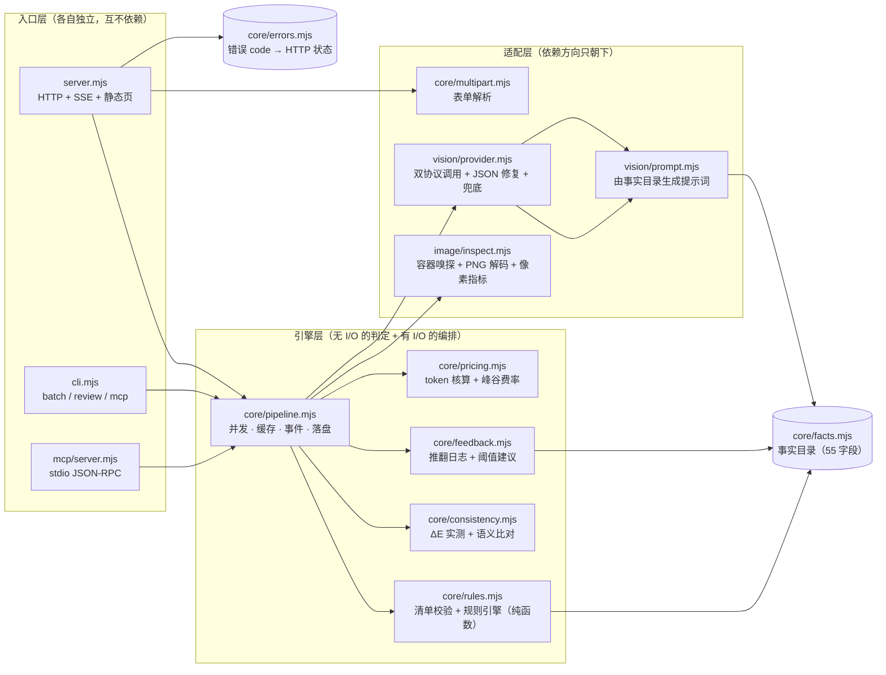
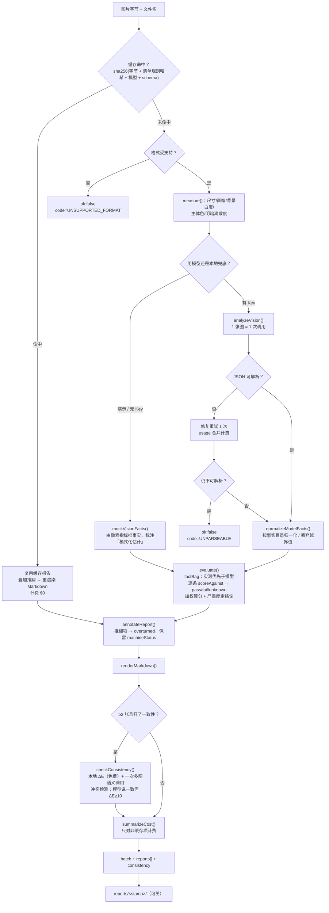
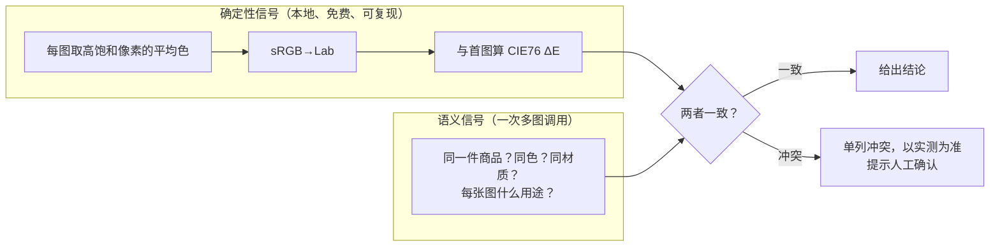
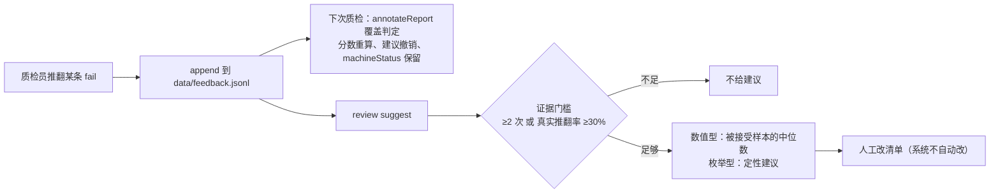

# 架构与数据流 · vision-qc-agent

> 本文说明**系统怎么搭**、**一次质检怎么走**、以及**为什么这样选**。
> 缺陷与整改见 [`audit-report.md`](audit-report.md)、[`fix-log.md`](fix-log.md)；使用方式见 [README](../README.md)。

---

## 1. 一句话架构

三个入口（HTTP / CLI / MCP）共用一条引擎链路：**测量 → 看图 → 判定 → 复核 → 汇总 → 组内一致性 → 计价 → 交付**。
模型只输出结构化事实，判定发生在本地纯函数里。

**依赖规则**（可当作代码评审的检查项）：

- 入口层可以依赖引擎层，反向不行；`core/` 不 import `server/cli/mcp`。
- `core/rules.mjs` 是纯函数：不读文件、不发请求、不碰全局状态，所以能离线单测 40+ 断言。
- 事实词汇表 `core/facts.mjs` 是唯一真相：提示词、清单校验、UI 下拉、模型输出归一化都从它派生，
  因此不会出现「改了清单忘了改提示词」。

---

## 2. 一次质检的完整数据流

### 数据形态怎么变

| 阶段 | 形状 | 关键字段 |
| --- | --- | --- |
| 输入 | `{name, buffer}` | 原始字节，不做解码 |
| measurement | `{format,width,height,aspectLabel,metrics}` | `metrics` 对 JPEG/WebP/GIF 为 `null`（诚实降级） |
| facts | `{textInImage:"heavy", productCoverage:58, ...}` | 只有事实目录里的键；越界值被丢弃并记录 |
| factBag | facts ∪ pipeline 实测 | **同名键以实测为准**（模型不许改分辨率） |
| result | `{id,status,observed,assertion,score,weight,suggestion}` | `status ∈ pass/fail/unknown/overturned` |
| report | `{score,verdict,counts,results,recommendations,markdown}` | 四处消费：UI / CLI / MCP / Markdown |

---

## 3. 三条独立业务线

### 3.1 单图判定（主线）

模型给语义（"文字多不多""布光好不好"），程序给像素（"背景白度 87.3%""最短边 520px"），
规则拿两者做断言。**分数 ≠ 结论**：分数衡量"离标准多远"，结论由严重度分布决定
（任一 high 失败 → 不合格；三条 medium 失败 → 不合格）。

### 3.2 SKU 组一致性（两个信号，故意不合并）

冲突检测是这个功能的**目的**而不是副产品：模型说"颜色一致"而实测 ΔE=49 时，
工具的价值就是把这句话顶回去。

### 3.3 人机回环

---

## 4. 关键设计决策

| 决策 | 为什么不选另一条路 | 代价 |
| --- | --- | --- |
| **模型只出事实，判定在代码** | 让模型直接出"合格/不合格"无法复现、无法解释、随温度漂移；也没法回答"为什么不合格" | 需要维护一份事实目录和一套表达式语义 |
| **像素指标自己算，不交给模型** | 分辨率、背景白度、主体色是可精确计算的；让模型估会引入无谓误差 | 只能解 PNG（零依赖前提下），JPEG/WebP 的实测指标缺失 |
| **一张图一次调用** | 一份清单 11-12 条规则共用一次视觉调用，加规则不增加成本 | 事实必须一次问全，提示词变长 |
| **缓存键含清单规则哈希** | 只用清单 id 做键，会把旧阈值的结论喂给新阈值 | 改一个阈值就让该清单的历史缓存全部失效（这是期望行为） |
| **零运行时依赖** | `npm start` 在任何装了 Node 20+ 的机器上都能跑，演示不会因装包失败翻车 | 自己写了 PNG 解码、multipart、SSE、JSON-RPC，维护成本转移到本项目 |
| **`unknown` 是独立状态** | 把"拿不到数据"算成通过会放过问题，算成不通过会冤枉商家 | 报告里要解释为什么拿不到（已有 `missingFactMessage`） |
| **推翻不自动改清单** | 静默按反馈放宽标准，最后会得到一条什么都通过的规则 | 需要人工确认，闭环慢一步 |
| **MCP 不声明 `outputSchema`** | 一旦声明，宿主会强制校验 `structuredContent`，容易报 `ToolOutputError` | 结构化输出的契约靠文档而不是 schema 约束 |

---

## 5. 错误语义

所有可预期的失败都带 `code`，HTTP 状态由 `core/errors.mjs` 单点映射：

| code | 语义 | 对外表现 |
| --- | --- | --- |
| `BAD_MULTIPART` | 请求不是合法 multipart | 400 |
| `BAD_JSON` / `BAD_FIELD` | 推翻接口的请求体不合法 | 400 |
| `UNKNOWN_CHECKLIST` | 清单 id 不存在（附可用列表） | 400 |
| `PAYLOAD_TOO_LARGE` | 超过上传上限 | 413 |
| `UNSUPPORTED_FORMAT` | 不是 PNG/JPEG/WebP/GIF | 422 |
| `TIMEOUT` / `NETWORK_ERROR` / `BAD_CREDENTIAL` / `UPSTREAM_ERROR` | 模型侧失败 | 该图 `ok:false`，其余图继续 |
| `UNPARSEABLE` | 两次调用都没给出可解析 JSON | 该图 `ok:false` |
| `NOT_PROCESSED` | 调度异常，该图未被处理 | 该图 `ok:false`（不再留数组空洞） |

单图失败不中断整批：`inspectBatch` 把异常收敛成 `{ok:false, error:{message, code}}`，
批次继续，`batch.failed` 计数。
