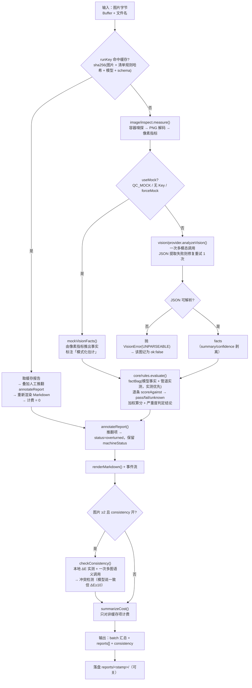
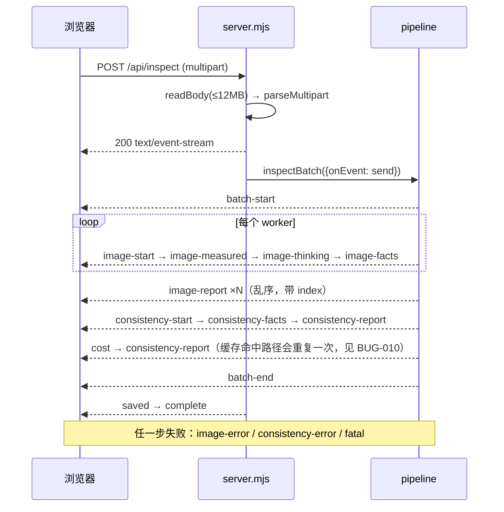
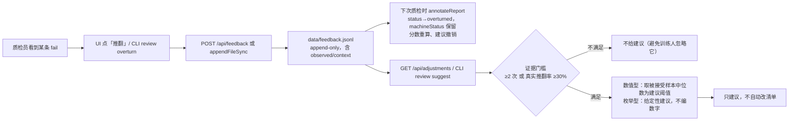

# 项目现状审计报告 · vision-qc-agent

> 审计对象：`vision-qc-agent` v0.2.0（git `ae0a10a`，工作树干净）
> 审计方式：全量读码 + 实际执行（单元测试、MCP 探针、无头浏览器 E2E、HTTP 边界探测、历史报告复核）
> 审计时间：2026-10-23
> 结论口径：**已验证缺陷**＝已通过执行复现；**代码确认**＝逻辑可判定但未构造运行时输入；**潜在风险**＝条件触发；**优化建议**＝无缺陷但可改进。

---

## 1. 项目实际功能与架构概览

### 1.1 它到底是什么

一个**清单驱动（checklist-driven）的多模态电商图片质检工具**，技术形态是 Node.js 零依赖服务 + 原生 JS 前端 + CLI + MCP stdio 服务器。

核心设计取舍（这是项目真正的技术主张，也是面试时的价值点）：

> **模型只负责"看"，判罚在一段可审计的本地代码里。**

即：多模态模型输出**结构化视觉事实**（`textInImage: "heavy"`），本地规则引擎拿事实 × 清单阈值做**确定性判定**。由此得到三个可验证的性质：

| 性质 | 直接后果 | 代码证据 |
| --- | --- | --- |
| 判定可复现 | 同 facts + 同清单 → 同分数，与模型温度无关 | `src/core/rules.mjs:127` `scoreAgainst()` 纯函数 |
| 阈值可调且零成本 | 改 `checklists/*.json` 不需要重新调模型 | `src/core/rules.mjs:234` `evaluate()` |
| 结论可解释 | 每条都带「实测 vs 要求」+ 改法 | `src/core/rules.mjs:257-271` |

规模实测（`wc -l`）：

| 层 | 行数 | 说明 |
| --- | --- | --- |
| `src/` | 3,953 | 业务与基础设施 |
| `public/` | 1,044 | 前端（无构建） |
| `test/` | 1,129 | 4 个测试/探针脚本 |
| `scripts/` | 397 | 样例图生成器 + DSH 集成安装器 |
| `checklists/` | 614 | 4 份清单（12 + 11 + 11 + 11 条规则） |
| git 跟踪 | 42 个文件 | `dependencies: {}`，**零外部运行时依赖** |

`src/` 里全部 `import` 都是 `node:` 内置模块（实测 grep 无第三方包名），零依赖这个卖点是**真的**，不是 README 话术。

### 1.2 技术栈与各自的实际用途

| 技术 | 实际用途 | 是否必要 |
| --- | --- | --- |
| `node:http` | HTTP 服务、SSE 进度流、静态文件 | 必要（替代 Express，是"零依赖"的实现） |
| `node:zlib` | `inflateSync` 解 PNG IDAT | 必要（自己实现 PNG 解码的前提） |
| 自写 PNG 解码 + unfilter | 背景白度/主体色/明暗离散度等像素指标 | 必要（避免引入 sharp/canvas 原生依赖） |
| 自写 multipart 解析 | 接收 `<input type=file multiple>` | 可替代（busboy 更稳），但换掉即失去零依赖 |
| OpenAI 兼容 / Anthropic 双协议 | 视觉模型调用 | 必要（不被单一厂商锁死） |
| 自写 JSON-RPC over stdio | MCP 服务器（6 个工具） | 必要（不引 `@modelcontextprotocol/sdk`） |
| 无框架前端（原生 DOM） | 上传、SSE 渲染、推翻表单 | 合理（规模只有 664 行） |
| CIE76 ΔE（Lab 空间） | SKU 组色差实测 | 必要（这是"实测压过模型"的物理依据） |

**没有**数据库、消息队列、向量库、Docker、RAG——审计确认这些缺席是合理的，项目没有需要它们的地方。

---

## 2. 目录结构与模块职责（逐项核对）

```
vision-qc-agent/
├── package.json            scripts 6 个入口；dependencies 为空；engines.node >=20.6
├── README.md               21.5 KB，14 节（功能/设计决策/运行/流程/清单/一致性/HITL/成本/MCP/结构/API/实测结果/边界/规划）
├── LICENSE                 MIT
├── .gitignore              data/ reports/ node_modules/ .env samples/*.html test/fixtures/ .workbuddy/
├── .github/workflows/ci.yml  Node 20+22 矩阵，node --check 全量语法 + npm test
├── checklists/             4 份 JSON 清单（真正的"业务资产"）
│   ├── ecom-main-image.json   12 条，5 high，4 组
│   ├── detail-page.json       11 条，3 high
│   ├── live-cover.json        11 条，6 high
│   └── design-review.json     11 条，2 high
├── src/
│   ├── server.mjs          253 行 · HTTP 入口：9 个路由 + SSE + 静态服务
│   ├── cli.mjs             326 行 · batch / review / mcp 三子命令
│   ├── config.mjs          171 行 · 环境 + 凭据解析（env → DSH → .env），providers 表
│   ├── core/
│   │   ├── facts.mjs       121 行 · 事实目录（55 个字段），清单/提示词/UI 的公共词汇表
│   │   ├── rules.mjs       389 行 · 清单校验 + 规则引擎 + 评分 + Markdown
│   │   ├── consistency.mjs 357 行 · ΔE + 语义比对 + 冲突检测
│   │   ├── feedback.mjs    292 行 · 推翻日志 + 阈值建议 + 报告叠加
│   │   ├── pricing.mjs     304 行 · token 归一化 + 峰谷费率 + 外推
│   │   ├── pipeline.mjs    376 行 · 编排：并发/缓存/事件/落盘
│   │   └── multipart.mjs    43 行 · multipart 解析
│   ├── image/
│   │   ├── inspect.mjs     368 行 · 容器嗅探 + PNG 解码 + 像素指标
│   │   └── synthetic.mjs   109 行 · 纯 Node PNG 编码（测试夹具）
│   ├── mcp/server.mjs      390 行 · MCP stdio，6 个工具
│   └── vision/
│       ├── prompt.mjs       96 行 · 由 facts 目录生成提示词
│       └── provider.mjs    358 行 · 双协议调用 + JSON 提取/修复 + mock 事实
├── public/                 前端：index.html(120) + app.js(664) + styles.css(260)
├── scripts/                make-samples.mjs（Chrome 渲染样例图）、install-dsh-integration.mjs
├── test/                   core.test(234) extensions(482) ui-e2e(217) mcp-probe(68) dsh-mcp-compat(128) + fixtures/
├── samples/                6 张 PNG（已入库，E2E 依赖它们）
├── docs/                   MCP 协议研究简报（489 行）、费率参考（150 行）
├── reports/                gitignored，21 个历史批次（含真实模型调用记录）
└── data/                   gitignored，feedback.jsonl + ui-e2e 浏览器 profile
```

### 依赖方向（无循环）

```
server.mjs ──┬─→ config.mjs
cli.mjs ─────┤
mcp/server.mjs┘
      │
      ▼
core/pipeline.mjs ─→ core/rules.mjs ─→ core/facts.mjs
      │            ─→ core/consistency.mjs ─→ (rgbToHex 内部)
      │            ─→ core/pricing.mjs
      │            ─→ core/feedback.mjs ─→ core/facts.mjs
      │            ─→ image/inspect.mjs
      ▼
vision/provider.mjs ─→ core/pricing.mjs
                    ─→ core/consistency.mjs（只为 buildConsistencyPrompt）
                    ─→ image/inspect.mjs（只为 mediaType）
                    ─→ vision/prompt.mjs ─→ core/facts.mjs
```

`core/*` 不反向依赖 `server/cli/mcp`，`rules.mjs` 是纯函数模块——分层是对的。唯一瑕疵：`vision/provider.mjs` 从 `core/consistency.mjs` 取 prompt 构造，导致 `core → vision → core` 的方向在同一层内出现「视觉层持有业务 prompt」的耦合（见 OPT-003）。

### 遗留文件与职责混淆

| 项 | 判断 |
| --- | --- |
| `docs/MCP-IMPLEMENTATION-BRIEF.md:13` 提到 `mcp-brief-verify/{server,drive,edge,plugin-e2e,timeout}.mjs` | **不在仓库中**，读者无法复核（BUG-013） |
| `test/fixtures/` 4 张 PNG | 由 `scripts/make-samples.mjs --png` 生成（`synthetic.mjs` 纯 Node 编码），被 `.gitignore` 排除；**当前没有测试引用它们**（测试直接用内存里的 `encodePng()`）。属于"生成后未被消费"的产物，不是死代码 |
| `.DS_Store` | 已忽略，未入库，无害 |
| `.workbuddy/` | 已忽略；属另一工具的记忆目录，与本项目无关 |
| `OPERATORS` 里的 `judge` / `!="` | 4 份清单**零使用**，但 `evaluate()`/`expressAssertion()` 为其写了专门分支 → 属预留能力，非死代码，但无测试覆盖 |

---

## 3. 端到端业务流程（以实际代码为准）

项目有**三个入口**，共用一条引擎链路。流程图分开画，不合并成理想化单链。

### 3.1 主链路（HTTP / CLI / MCP 共用）



### 3.2 事件流（SSE）——前端状态机的真实依据



关键实现事实（读码确认）：

- **并发模型**：`worker()` 共享游标 + `Promise.all`，并发数 = `min(config.concurrency, 图片数)`。JS 单线程，游标无需加锁。
- **乱序安全**：报告按**队列索引**回填 `reports[index]`，不按文件名配对（`pipeline.mjs:93-99` 有注释说明），这是对的——同名文件跨目录很常见。
- **计费口径**：只对 `!report.cached` 计费（`pipeline.mjs:127`），缓存重放计为 `$0`。
- **事件是"渐进式"的**，前端依赖 `image-report` 的 `index` 去取缩略图 URL。

### 3.3 人机回环（第二条业务线）



---

## 4. 核心接口与数据契约

### 4.1 HTTP API（9 个路由，逐个核对）

| 方法 | 路径 | 输入 | 输出 | 实测状态 |
| --- | --- | --- | --- | --- |
| GET | `/api/health` | — | `{ok, config: publicConfig}` 不含密钥 | ✅ 200 |
| GET | `/api/checklists` | — | `{checklists: 已校验清单}` | ✅ 200 |
| GET | `/api/facts` | — | `{facts: FACT_CATALOG}` | ✅ |
| GET | `/api/reports` | — | 进程内缓存的摘要 | ✅ |
| POST | `/api/inspect` | multipart：`images[]` `checklistId` `mock` `consistency` | **SSE** 18 种事件 | ⚠️ 见 BUG-004/005/006 |
| GET | `/api/feedback` | — | `{total, reasons, byRule, records[-200:]}` | ✅ |
| POST | `/api/feedback` | JSON `{imageName, ruleId, reason, note, reviewer, context}` | 201 / 400 | ✅ 非法原因与非法 JSON 均 400 |
| GET | `/api/adjustments` | `checklistId` `reload` | `{suggestions}` | ✅ |
| GET | `/api/pricing` | — | 费率表 + 样例 | ✅ |

### 4.2 关键数据结构契约

**measurement（管道产出，规则的事实来源之一）**

```
{ name, format, supported, mediaType, width, height, bytes,
  megapixels, aspect, aspectLabel, rectangle,
  metrics: { lumaMean, lumaSd, borderLuma, borderSd, borderWhiteness,
             nearWhiteRatio, veryWhiteRatio, saturationRatio, colorRatio,
             dominantLumaBucket, darkRatio, centerInkRatio,
             highContrastRowRatio, subjectColor:{r,g,b,coverage}|null,
             sampledPixels, sampleStep } | null,
  metricsNote }
```

契约断裂点：`metrics` 为 `null`（JPEG/WebP/GIF）时，`factBag` 把 `backgroundWhiteness` 等 6 个 pipeline 事实置为 `undefined` → 相关规则降级 `unknown`。**这个降级是有意的**，但下游必须能承受 `metrics===null`——`consistency.compareSubjectColors` 已用 `?? null` 兜住，正确。

**report（单图结果，前端/CLI/MCP/Markdown 四处消费）**

```
{ ok, key, cached, cachedAt, score, verdict, verdictLabel,
  counts:{pass,fail,unknown,total,overturned?},
  severityBreakdown:{high,medium,low},
  results:[{id,group,title,severity,weight,status,observed,assertion,
            score,suggestion,source,reason,machineStatus?,override?}],
  recommendations:[{id,severity,title,observed,assertion,suggestion}],
  checklist:{id,name,version,meta}, model:{provider,model,ms,usage,summary,confidence},
  image:{...measurement, fileSizeKB, metrics},
  facts, cost, prompt:{model,mode,ms,usage,repaired,finishReason,truncated},
  markdown }
```

**四处消费方的假设差异（审计发现）**：`renderMarkdown` 依赖 `counts.overturned` 单独一行；`annotateReport` 重算的 `counts.pass` 与 `total` 不相加（BUG-011）；MCP `renderBatchText` 依赖 `report.image.name` 一定存在——而 pipeline 在 worker 未执行时会留下数组空洞（BUG-003）。

**checklist 契约**：`{id,name,version,description,meta,rules[]}`，每条 `{id,title,fact,op,value,severity?,weight?,why?,suggest?,group?,unit?,source?,threshold?,floor?,ceiling?,tolerance?}`。校验器只检查了 `fact` 是否在目录、`op` 是否合法、`in/between` 的 value 形状——**未校验 value 类型与数值序**（BUG-009）。

**MCP 工具契约**：6 个工具，全部声明 `additionalProperties:false` 的 object schema，**不声明 `outputSchema`**（`mcp/server.mjs:313` 有注释解释：一旦声明，DSH 会强制校验 `structuredContent`，容易报 `ToolOutputError`）。这是踩过坑之后的正确选择。

---

## 5. 问题清单与风险分级

共 **16 项**：P0 ×0，P1 ×3，P2 ×7，P3 ×2，P4 ×4。

### 5.1 P1（高）

#### BUG-001 · 单元测试依赖系统时钟，在 DeepSeek 错峰时段必然失败

| 字段 | 内容 |
| --- | --- |
| 类型 | 测试 / 可重复性 |
| 证据 | `test/extensions.test.mjs:135-137` |
| 描述 | `ratesFor("deepseek","deepseek-v4-flash-vision-exp")` 未传 `at`，`pricing.mjs:103` 用 `new Date()` 判断峰谷；断言硬写 `rates.input === 0.3`（高峰价）。错峰时段返回 `0.15`。 |
| 触发条件 | 运行 `npm test` 的时刻落在错峰窗口（UTC 00–01、04–06、10–24 及周末全天） |
| 影响 | CI 每天约 3/4 时间必红；README「42 个离线用例」的可信度受损；维护者会误以为费率算错 |
| 验证状态 | **已复现** — 2026-10-23 18:20 CST（10:20 UTC）：`0.15 !== 0.3`，42 tests / 41 pass / 1 fail |
| 修复方案 | 断言处显式传 `at:"2026-09-17T02:00:00Z"`（高峰），另加一条错峰断言 |
| 验收 | 在任意时刻运行 `npm test` 均 100% 通过；grep 该文件无未固定时刻的 `ratesFor` |

#### BUG-002 · UI E2E 断言绝对条数且写真实数据目录，第二次运行必失败并污染演示数据

| 字段 | 内容 |
| --- | --- |
| 类型 | 测试 / 数据隔离 |
| 证据 | `test/ui-e2e.mjs:188-189`（断言 `/已记录 1 条/`）、`:205-221`（POST 到真实服务）、`src/server.mjs:38`（feedback 固定指向 `<appRoot>/data/feedback.jsonl`） |
| 描述 | 测试点击「确认推翻」向项目真实日志追加一条记录，然后断言面板显示"已记录 **1** 条"。日志是 append-only 持久化文件，第二次运行必然变成 2 条。 |
| 触发条件 | 第二次及以后运行 `npm run test:ui`；或手动演示后再跑测试 |
| 影响 | ① 测试不可重复（实测 12/13）；② `data/feedback.jsonl` 里留下 `note:"UI 端到端测试"` 的假记录，之后所有对 `01-perfect-white.png` 的质检都会被它推翻，README §12 的样例分数不再可复现；③ 直接污染的是作品集演示数据 |
| 验证状态 | **已复现** — 首次运行 13/13 通过；本次运行 12/13，失败项「复核面板统计已刷新 — 已记录 2 条推翻」，且 `data/feedback.jsonl` 新增 1 条 |
| 修复方案 | ① `config` 增加 `dataDir`（`QC_DATA_DIR` 可覆盖）；② E2E 改为**自托管**：自己拉起 `QC_MOCK=1 QC_DATA_DIR=<tmp> QC_NO_SAVE=1` 的服务，用完杀掉；③ 保留 `QC_URL` 逃生口指向外部服务 |
| 验收 | 连续运行 3 次 `npm run test:ui` 均 13/13；运行前后 `data/feedback.jsonl` 行数不变 |

#### BUG-003 · 环境变量数值未校验 → 静默零处理 + CLI 崩溃

| 字段 | 内容 |
| --- | --- |
| 类型 | 配置 / 可靠性 |
| 证据 | `src/config.mjs:134-137`（`Number(process.env.QC_CONCURRENCY \|\| 3)` 等 5 处）、`src/core/pipeline.mjs:91`、`src/cli.mjs:159`、`src/mcp/server.mjs:158` |
| 描述 | `QC_CONCURRENCY=abc` → `NaN` → `Math.max(1, Math.min(NaN, n))` = `NaN` → `Array.from({length:NaN})` 得空数组 → `Promise.all([])` 立即完成、**一个 worker 都没跑** → `reports` 全为空洞、`ok:0 failed:1`（把"没处理"记成"失败"）。随后 CLI 在 `report.image.name` 处抛 `TypeError`。 |
| 触发条件 | `QC_CONCURRENCY` / `QC_MAX_IMAGES` / `QC_MAX_UPLOAD_BYTES` / `QC_PORT` / `QC_TIMEOUT_MS` 被写成非数字或越界值。`QC_MAX_UPLOAD_BYTES=abc` 更隐蔽：`size > NaN` 恒为 false → **上传上限完全失效**。 |
| 影响 | 诊断成本高（日志里没有任何线索）；服务端返回 0 结果的 SSE 流；CLI 直接崩；MCP 工具抛 `TypeError` 而非可读错误 |
| 验证状态 | **已复现** — `QC_CONCURRENCY=abc npm run cli samples/01-perfect-white.png` → `运行失败：Cannot read properties of undefined (reading 'image')`；同参数下 `batch.ok=0, failed=1, reports=[null]` |
| 修复方案 | ① `config.mjs` 加 `intFromEnv()`：非法即抛带变量名与期望范围的错误（fail fast）；② `pipeline` 侧把 worker 数包一层 `Number.isFinite` 兜底，并在 `Promise.all` 后**把空洞补成 `{ok:false,error:{code:"NOT_PROCESSED"}}`**；③ CLI/MCP 渲染前用 `report?.ok` 守卫 |
| 验收 | 非法值启动即报错并指明变量；即便绕过，`reports` 无空洞、`ok+failed === total`；CLI 不崩 |

### 5.2 P2（中）

#### BUG-004 · 非图片文件被接受，真实模式下会发起必然失败的计费调用

| 字段 | 内容 |
| --- | --- |
| 类型 | 输入校验 / 成本 |
| 证据 | `src/server.mjs:189-193`（无格式校验）、`src/image/inspect.mjs:16-24`（返回 `"unknown"`）、`src/vision/provider.mjs:62-64`（`data:image/unknown;base64,...`） |
| 描述 | 上传 25 字节文本、命名为 `fake.png`：`format=unknown`、`width=0`、`metrics=null`。mock 模式下 `mockVisionFacts` 走"无法解码"分支，**生成整套伪事实**并给出"不合格"结论（0×0 触发 R04/R06 失败）；真实模式下会把 `data:image/unknown` 发给模型，必然 4xx，但仍计入一次请求。 |
| 触发条件 | 上传非 PNG/JPEG/WebP/GIF 的字节（PDF、文本、空文件、带正确扩展名的损坏文件） |
| 影响 | 用户看到的是"不合格"而不是"这不是图片"；真实模式白花一次调用；结论不可信 |
| 验证状态 | **已复现** — `curl -F images=@fake.png` → SSE 返回 `{"format":"unknown","width":0,"height":0,"metrics":null}` 并继续产出判定 |
| 修复方案 | `measure()` 之后、调模型之前校验 `measurement.supported`；不支持则抛 `QcError("UNSUPPORTED_FORMAT")`，由 pipeline 记为 `ok:false`，在前端/CLI 显示为"失败：不支持的图片格式" |
| 验收 | 上传文本文件 → `image-error` 事件带 `code:"UNSUPPORTED_FORMAT"`；不产生任何模型调用；`batch.failed` 计数正确 |

#### BUG-005 · 畸形 multipart 请求返回 500 而非 400

| 字段 | 内容 |
| --- | --- |
| 类型 | API 语义 |
| 证据 | `src/core/multipart.mjs:17` 抛普通 `Error`、`src/server.mjs:227-236` 兜底 500 |
| 描述 | `POST /api/inspect` 带 `content-type: text/plain` → `parseMultipart` 抛「缺少 multipart boundary」→ 落入全局 catch → **500**。 |
| 触发条件 | 客户端未按 multipart 构造请求（curl 手测、错误的 SDK） |
| 影响 | 客户端无法区分"我请求错了"和"服务端崩了"；监控误报 |
| 验证状态 | **已复现** — `curl -X POST -H 'content-type: text/plain' --data x` → `500 {"error":"缺少 multipart boundary"}` |
| 修复方案 | `parseMultipart` 抛带 `code:"BAD_MULTIPART"` 的错误；server 的 catch 里按 code 映射 400 |
| 验收 | 同上请求返回 400；正常 multipart 不受影响 |

#### BUG-006 · 未知 checklistId 静默回退，调用方无从得知

| 字段 | 内容 |
| --- | --- |
| 类型 | 接口契约 |
| 证据 | `src/core/pipeline.mjs:60` `?? checklists[0]` |
| 描述 | 传 `checklistId=does-not-exist`，实际用第一份清单 `ecom-main-image` 执行，`batch-start` 事件里报告的是 `ecom-main-image`，但 HTTP 状态仍是 200、事件序列完整，调用方没有任何"你传的 id 不存在"的信号。 |
| 触发条件 | 拼错清单 id / 清单被删 / 前端缓存了旧 id |
| 影响 | 用错标准质检，结论看着完全正常 —— 这是最危险的一类静默错误 |
| 验证状态 | **已复现** — `curl -F checklistId=does-not-exist` → `batch-start.checklist.id = "ecom-main-image"` |
| 修复方案 | 显式给出 id 但找不到时抛 `UNKNOWN_CHECKLIST`（400，附可用 id 列表）；未提供时仍默认第一份 |
| 验收 | 未知 id → 400 + 可用 id；省略 id → 行为不变 |

#### BUG-007 · 超量图片被静默截断

| 字段 | 内容 |
| --- | --- |
| 类型 | 数据完整性 |
| 证据 | `src/server.mjs:190-192` `.slice(0, config.maxImages)`、`src/mcp/server.mjs:138` `paths.slice(0, 12)` |
| 描述 | 上传 20 张只处理 12 张，`batch.total` 记为 12，**没有 `dropped` 字段也没有事件**。MCP 侧 `qc_inspect_images` 传 20 个路径同样静默丢 8 个，宿主模型会以为全部检过。 |
| 触发条件 | 图片数 > `maxImages`（默认 12） |
| 影响 | Agent 场景下会"漏检而自认为检全了"，比报错更糟 |
| 验证状态 | **代码确认** |
| 修复方案 | server：`batch-start` 增加 `dropped` 字段 + 一条 `batch-warning` 事件；MCP：返回文本里写明"只处理了前 12 个，忽略 N 个" |
| 验收 | 传 20 张 → 事件与返回文本都出现丢弃数量；`total + dropped = 请求数量` |

#### BUG-008 · 模型返回的字段未经类型/枚举校验，格式错误被呈现为商品缺陷

| 字段 | 内容 |
| --- | --- |
| 类型 | AI 输出校验 / 结论可信度 |
| 证据 | `src/vision/provider.mjs:290` `const { summary, confidence, ...fields } = facts;` → 原样返回；`src/core/rules.mjs:127-184` 直接按值比较 |
| 描述 | facts 未按 `FACT_CATALOG` 校验就进入规则引擎。模型返回 `textInImage:"None"`（首字母大写）或 `"none "`（尾空格）→ `scoreAgainst` 的 `in` 分支严格 `===` → **判 fail**；返回 `hasWatermark:"false"`（字符串）→ `==` 布尔分支 `"false" === false` 为假 → **判 fail**。报告显示「实测 false / 要求 == false / 不通过」，自相矛盾。 |
| 触发条件 | 模型输出枚举大小写/空白/中英文不一致，或布尔输出成字符串（LLM 常见） |
| 影响 | 把"模型没按格式答题"误报成"商品有问题"，直接损害结论可信度；且无法从报告里看出真实原因 |
| 验证状态 | **代码确认**（`extractJson` 之后无任何 schema 校验，全仓库 grep `validateFacts` 无结果） |
| 修复方案 | 新增 `normalizeFacts()`：按目录归一化 bool（`"true"/"false"/"是"/"否"/1/0`）、percent（数字或数字字符串，clamp 0–100）、enum（trim + 精确 → 小写匹配 → 仍不匹配则**丢弃**）、number；统计 `coerced/dropped` 写入 `meta.normalized` |
| 验收 | 新增单测：`"None"→"none"`、`"false"→false`、`"heavy "→"heavy"`、`"nonsense"→字段消失且规则为 unknown`；报告 `model.normalized` 可见 |

#### BUG-009 · 清单校验不检查 value 类型，阈值可静默失效

| 字段 | 内容 |
| --- | --- |
| 类型 | 配置校验 |
| 证据 | `src/core/rules.mjs:34-79`（校验了 fact/op/severity/in/between 形状）、`src/core/rules.mjs:129` `const target = typeof rule.value === "number" ? rule.value : 0` |
| 描述 | `{op:">=", value:"800"}`（字符串）→ `target=0` → 规则退化成 `minSide >= 0`，**永远通过**，且报告里显示「要求 最短边像素 >= 800」——页面说 800，实际按 0 判。`between:[100,50]`（min>max）不被拒绝，评分公式 `span=max(-50,1)=1` 产出无意义分数。 |
| 触发条件 | 手写清单阈值时写错类型/顺序（这正是 README 鼓励的行为："加一条新规则只要三行"） |
| 影响 | 质检形同虚设却毫无提示，属于"看起来很对但完全失效"的错误 |
| 验证状态 | **代码确认** |
| 修复方案 | `validateChecklist` 增加：有序比较符要求 `Number.isFinite(value)`；`between` 要求两元素均为有限数且 `min <= max`；`in` 要求非空数组；`==/!=` 要求 value 非 null/undefined |
| 验收 | 4 份现有清单仍全部通过；上述三种错误配置各被拒并给出字段路径 |

#### BUG-016 · 未知 provider 仍按 DeepSeek 调用，但成本面板记为 $0

| 字段 | 内容 |
| --- | --- |
| 类型 | 配置 / 成本核算 |
| 证据 | `src/config.mjs:129` `const active = providers[provider] ?? providers[DEFAULT_PROVIDER]`、`src/core/pricing.mjs:97-99` `ratesFor()` 查不到就返回 `undefined` |
| 描述 | `QC_PROVIDER=bogus` → 传输层回退到 DeepSeek（`api`/`baseURL` 都是 DeepSeek 的），但 `config.provider` 仍是 `bogus`。`costOf({provider:"bogus"})` 查不到费率表 → 返回 `undefined` → `report.cost = null` → `batch.cost.images = 0` → 成本面板打印「本次未调用模型（本地兜底），成本 $0」。实际情况是**调用了、也扣费了**。同时 UI 横幅显示 `bogus` 这个不存在的供应商名。 |
| 触发条件 | `QC_PROVIDER` 拼错或填了未支持的 id（例如想接自建网关时编了一个新名字） |
| 影响 | 成本感知完全失真（这是"钱"的问题）；排障时看不到真实线路 |
| 验证状态 | **已复现** — `QC_PROVIDER=bogus node ...` → `provider=bogus / api=openai-completions / baseURL=https://api.deepseek.com/v1 / cost=undefined` |
| 修复方案 | `loadConfig()` 对 provider 做白名单校验，未知即抛错并列出可选项；自定义网关用 `QC_BASE_URL` + 现有 id |
| 验收 | `QC_PROVIDER=bogus` 启动即报错；三个合法 id 行为不变 |

### 5.3 P3（低）

#### BUG-010 · 一致性缓存命中时 `consistency-report` 事件重复发送

| 字段 | 内容 |
| --- | --- |
| 类型 | 事件契约 |
| 证据 | `src/core/pipeline.mjs:114`（缓存分支发一次）与 `:167`（无条件再发一次） |
| 描述 | 非缓存路径只发 1 次，缓存路径发 2 次。前端 `renderConsistency` 会 `innerHTML=""` 重绘，所以视觉上无异常，但消费 SSE 的第三方客户端会重复处理同一结论。 |
| 验证状态 | **代码确认** |
| 修复方案 | 删除缓存分支内的 emit，统一由 `:167` 发送 |
| 验收 | 缓存与非缓存各收到恰好 1 次 `consistency-report` |

#### BUG-011 · `annotateReport` 的 `counts.pass` 与 `total` 不相加

| 字段 | 内容 |
| --- | --- |
| 类型 | 统计口径 |
| 证据 | `src/core/feedback.mjs:288` `pass: results.length - failed.length - unknown.length` |
| 描述 | 被推翻项已从 `failed` 中移除，但 `pass` 仍按 `total - fail - unknown` 算，等于**把 overturned 计进了 pass**；而 `counts.overturned` 又单独上报一次。Markdown 里「通过 X / 不通过 Y / 未判定 Z（共 N）」三个数相加不等于 N。 |
| 验证状态 | **代码确认**（`evaluate()` 里的同名字段是 `results.length - failures - unknown`，此时无 overturned，故正确） |
| 修复方案 | 改为 `pass: results.filter(r => r.status === "pass").length`，使 `pass+fail+unknown+overturned === total` |
| 验收 | 新增断言：四类之和 === total |

### 5.4 P4（建议）

| ID | 类型 | 证据 | 问题 | 建议 |
| --- | --- | --- | --- | --- |
| BUG-012 | 文档 | `README.md` §13 第 5 条 | 写「实测同一张 **500px** 的图，两次得到 88/87 …因为一条 **high** 规则的临界通过/不通过」。核对 `reports/2026-09-17T09-02-11` 与 `09-13-51`：该图实为 **1000×1000**；两次结论差别的真实原因是 88 分批次 2 条 medium 失败→`warn`，87 分批次 **R05（medium）** 也失败→3 条 medium→`fail`。不存在 high 规则翻转。 | 按实测报告改写，并保留"三条 medium 即不合格"这个真实机制 |
| BUG-013 | 文档 | `docs/MCP-IMPLEMENTATION-BRIEF.md:13` | 引用 `mcp-brief-verify/{server,drive,edge,plugin-e2e,timeout}.mjs` 作为验证产物，仓库中不存在 | 注明"研究期临时验证脚本，未随仓库发布"，或移除该句 |
| BUG-014 | 测试覆盖 | `src/server.mjs` 全部 253 行 | HTTP 层零自动化测试：9 个路由、SSE 帧、上传上限、静态目录穿越、状态码语义都没有用例；`test/mcp-probe.mjs` 只 `console.log` 不 `assert`，CI 也不跑它 | 新增 `test/http.test.mjs`（离线、mock、进程内启动 server）；给 MCP 探针加断言并以非零码失败 |
| BUG-015 | 工程规范 | 仓库根 | 缺 `.env.example`（5 个 `QC_*` 变量只散落在 README 与 config 注释里）；未说明如何**重置演示数据**（`data/feedback.jsonl` 会让样例分数漂移） | 补 `.env.example`；README §13 增补"重置演示"一行 |

### 5.5 优化建议（无缺陷，可选）

| ID | 位置 | 建议 | 收益 |
| --- | --- | --- | --- |
| OPT-001 | `pipeline.mjs` / `server.mjs` | `reportCache` / `consistencyCache` 无上限，长期运行会持续占内存 | 加 LRU 上限（如 200 条） |
| OPT-002 | `provider.mjs:66-92` | 只有 JSON 修复重试，无 429/5xx 退避重试 | 批量场景下降低单图失败率（需先做限流，否则会放大 429） |
| OPT-003 | `provider.mjs:17` | 视觉层从 `core/consistency.mjs` 取 prompt 构造，方向略反 | 把 prompt 构造移到 `vision/`，`core` 只保留纯判定 |
| OPT-004 | `rules.mjs:164` | `==` 数值容差默认 10% 是魔法数 | 提升为具名常量并在清单文档里说明 |
| OPT-005 | `server.mjs` | 未设 CSP / `X-Content-Type-Options` | 本地演示风险低；若将来对内网开放再补 |

---

## 6. 架构与安全专项结论

### 6.1 做得对的地方（审计确认，不是客套）

1. **模型/规则分层真实落地**：`rules.mjs` 是纯函数、零 I/O、零模型依赖，`scoreAgainst` 可单测——这是"可审计判定"的物理保证。
2. **缓存键设计有洞察**：`runKey` 把**清单规则内容的 sha256** 而非 id 纳入键（`pipeline.mjs:28-35`），因此改阈值会自然失效缓存。注释直接点明了"naive id-only 会把旧结论喂给新阈值"这个坑。
3. **失败可区分**：`unknown`（拿不到事实）与 `fail`（拿到但不达标）是两种状态，且 `verdict: unknown` 独立存在。这比"默认通过"或"默认不通过"都诚实。
4. **静默降级有标注**：mock 事实的 `summary` 一律前缀 `[模式化估计]`，报告与 UI 都显式标"本地兜底（非模型判断）"。
5. **成本口径正确**：缓存命中/未命中分桶、推理 token 不重复计费、峰谷分段——三个最容易算错的点都写了注释和测试。
6. **人工推翻不改机器原判**：`machineStatus` 保留，`recommendations` 撤销——审计链条完整。
7. **`outputSchema` 故意不声明**：有注释说明 DSH 会强制校验 `structuredContent`，这是踩坑后的正确取舍。
8. **密钥不回传前端**：`publicConfig()` 只暴露 `keyEnv` 与 `credentialSource`，不暴露 key 值。实测 `/api/health` 无密钥。

### 6.2 安全与隐私（结合真实入口判断）

| 检查项 | 结论 |
| --- | --- |
| 仓库内敏感信息 | **未发现**（对 `*.mjs/*.js/*.json/*.md/*.yml` 全量正则扫描 `sk-…`、`api_key=…`，零命中） |
| 密钥来源 | env → `~/.dsh/.credentials.yaml` → `.env`；`.env` 已 gitignore；`.credentials.yaml` 在 home 目录外于仓库 |
| 静态目录穿越 | **实测安全**：`/../package.json`、`/%2e%2e/package.json`、`/..%2fpackage.json`、`/../../etc/passwd` 全部 404。原因是 `new URL()` 归一化 `..`，且 `%2e` 不被 decode，`join` 后落在 `public/` 不存在路径；另有 `startsWith(PUBLIC_DIR + sep)` 白名单 |
| 上传文件写入磁盘 | `saveReports` 的文件名经 `[^\p{L}\p{N}._-]+ → _` 过滤，`/` 与 `\` 都变 `_`，无法穿越；同名自动加后缀 |
| 服务暴露面 | 只监听 `127.0.0.1`，无鉴权——**定位为本地演示，可接受**；README 已声明。**若部署到内网/公网则 P0** |
| 上传体积 | 有 12MB 上限，但 `QC_MAX_UPLOAD_BYTES` 非法时上限失效（BUG-003） |
| 错误信息泄露 | 上游错误只透出 `text.slice(0,400)`，不含本地路径；本地异常信息含绝对路径（如 ENOENT），仅本地可见 |
| 图像隐私 | 样例图是自造矢量渲染图，不含人脸/PII；真实使用会把商品图上传第三方模型，README 未提示这一点（建议补一句数据流向说明） |
| 第三方许可 | MIT；模型输出与样例图均自产，无第三方素材 |

### 6.3 性能（区分实测与推测）

**有实测数据的**（来自 `reports/2026-10-23T09-09-17/batch.json`，真实模型调用）：

| 指标 | 实测值 |
| --- | --- |
| 6 图 + 1 次一致性调用总耗时 | 65,725 ms |
| 单图平均 token | 5,183（输入 15,394 / 输出 15,703，其中推理 13,633） |
| 缓存命中 | 86.5% |
| 总成本 | $0.02527（含一致性 $0.00572） |
| 一致性调用占比 | 22.6% 成本 / 8,129 tokens |

**没有实测数据、只记录为潜在瓶颈的**：

- 12MP 级 PNG 的 `unfilter` 是纯 JS 逐字节循环，未做基准测试；`sampleBudget=40000` 只限制了**采样**，解码本身仍是全图。
- `reportCache` 无上限（OPT-001）。
- 一致性检查是"整组一次调用"，12 张图会顶到上下文上限——README 已声明，未测过具体在哪张失败。

**不做结论的部分**：没有压测，不声称任何 QPS / 吞吐量。

---

## 7. 整改优先级与顺序

| 顺序 | 项 | 理由 |
| --- | --- | --- |
| 1 | BUG-001、BUG-002 | 测试是"证据链"的地基。现在 `npm test` 会红、E2E 会红，任何后续修复都无法可信验证 |
| 2 | BUG-003、BUG-016 | 都在 `loadConfig()` 一处：一个变量写错就静默零产出 + 崩溃，另一个让成本面板显示 $0 却真的扣了钱 |
| 3 | BUG-004、005、006、007 | 全部集中在"输入 → 引擎"边界，一次改完可整体回归 |
| 4 | BUG-008、009 | 影响结论正确性，但改动涉及事实归一化与校验器，需配套新测试 |
| 5 | BUG-010、011 | 契约与统计口径，改动 2-3 行 |
| 6 | BUG-014、015、012、013 | 补测试与文档，最后做 |

**暂缓**：OPT-001～005 均无当前缺陷，且 OPT-002（退避重试）在无限流的前提下会放大 429，不建议现在做。

---

## 8. 审计边界声明

本报告的结论仅限于：

- 审计时刻的 `main` @ `ae0a10a` + 当前工作树（`git status` 干净）。
- 本机 macOS + Node 22.22.2 环境。
- 真实模型调用部分**复用历史批次记录**（`reports/`，按 `.gitignore` 不入库，读者无法直接打开这些原始文件，只能按 README 的方式重跑复现）；本次所有运行均为 `QC_MOCK=1` 或纯本地函数。
- 未覆盖：Node 20 运行时差异（CI 矩阵声明但本地未跑）、Windows 路径行为、超 12MB 上传、并发多客户端压力、真实 4K/12MP 大图性能。
